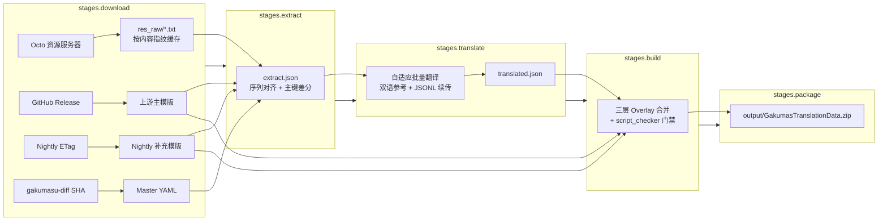

# gkm-tl

《学园偶像大师》(Gakuen iDOLM@STER / 学マス) 游戏文本自动化翻译与增量构建工具。

`gkm-tl` 是一套端到端自动化汉化流水线：直接连接游戏资源服务器拉取最新日文资源，结合社区汉化模版与 Master 差分数据库进行序列对齐与主键级增量比对，调用 LLM 进行带双语术语参考与角色设定的批量结构化翻译，最终通过三层 Overlay 合并与语法门禁校验生成可直接用于汉化插件的资源包。

---

## ✨ 核心特性

- **多源版本指纹与按需同步** — 同时追踪 Octo 资源清单（含单文件 `objectName/md5` 内容指纹）、上游 Release 版本号与 `gakumasu-diff` Commit SHA；仅在任一上游源实际更新时才拉取对应增量资源，彻底避免因第三方差分库延迟更新而漏翻新卡数据。
- **高精度增量差分与事件对齐** — 覆盖 4 类游戏文本格式：
  - **ADV 剧情脚本 (`resource`)**：统一基于 `Campus.ADV` 语法扫描器提取并按精确字符区间回写，通过序列对齐（`SequenceMatcher`）抵抗增删演出指令导致的行号偏移，杜绝译文错位覆盖。
  - **Master 数据表 (`master`)**：支持标量字段与字符串数组（如 `Tutorial.texts[]`），支持复合主键匹配、已有表新记录自动追加、新建非 `id` 主键表自动生成，以及空字符串占位条目的 Nightly 回退。
  - **Generic / Localization**：严格区分未译源文本与已确认中文译文，杜绝未译日文混入参考上下文。
- **三层 Overlay 构建与语法门禁** — 构建底包按 `Nightly 补充包 → 上游 Release 主包 → 本轮新增译文` 三层合并，既保证上游人工汉化绝对优先，又完整保留 Nightly 新增文件与键值；新译脚本自动执行 `script_checker` 语法/标签/占位符门禁校验。
- **自适应批处理与高可靠容错** — 双重受控批大小（条数 `batch_size` + 字符预算 `max_batch_chars`），连接池复用与 `429/5xx` 指数退避重试；遇到 `finish_reason == "length"` 截断自动抢救已完成前缀并二分拆批，遇到致命配置错误（`401/403/400`）快速失败防雪崩；采用 $O(1)$ 追加写 `translate_checkpoint.jsonl` 断点续传。

---

## 🏗️ 架构与流水线

项目采用进程内（In-Process）五阶段流水线架构，各阶段既可通过 `run.py` 零子进程开销串联执行，也可独立作为 CLI 运行：



### 流水线阶段详解

| 阶段 | 模块 | 职责与核心逻辑 | 产物 / 缓存 |
| :--- | :--- | :--- | :--- |
| **Stage 1: 下载** | `stages/download.py` | 探测 `(octo_revision, mod_version, gkm_diff_sha)` 联合指纹；若全部未变且无未完成 Checkpoint，写入 `nothing_to_translate` 秒级跳过；否则按内容指纹增量下载 `adv_*.txt`，按 tag / ETag / SHA 按需更新模版与 Master YAML。 | `cache/server/`<br/>`cache/mod/`<br/>`cache/nightly/`<br/>`cache/gkm-diff/` |
| **Stage 2: 提取** | `stages/extract.py` | 提取 `resource` / `master` / `generic` / `localization` 四类数据，建立唯一 UID 与 16 位 `blake2s` 请求短标识 `hash`，精准标记 `new` / `existing` / `changed`。 | `cache/extract.json` |
| **Stage 3: 翻译** | `stages/translate.py` | 按文件分组并按条数与字符预算自适应切批，从同文件已译条目中抽取就近双语词条作为 `[参考译文]`；携带 `json_schema` 严格按短标识对齐；支持截断前缀抢救、二分拆批、单条兜底与 `translate_checkpoint.jsonl` 追加续传。 | `cache/translated.json`<br/>`cache/translate_checkpoint.jsonl` |
| **Stage 4: 构建** | `stages/build.py` | 按 `Nightly → Upstream Mod → 新译文` 三层合并重构 `GakumasTranslationData`：精确回写 ADV 脚本并运行 `script_checker` 校验，向 `masterTrans/*.json` 更新已有记录并插入新增记录，写回双语歌词容器与 `localization.json`。 | `output/GakumasTranslationData/`<br/>`cache/master_source_snapshot.json` |
| **Stage 5: 打包** | `stages/package.py` | 原子生成包含显式 `local-files/` 目录项的插件兼容归档 `GakumasTranslationData.zip`，并提交已完成的多源指纹清单 `source_manifest.json`。 | `output/GakumasTranslationData.zip`<br/>`cache/source_manifest.json` |

---

## 🚀 快速开始

### 1. 环境准备

- **Python** $\ge$ 3.12
- **[uv](https://docs.astral.sh/uv/)**

### 2. 安装依赖

```bash
git clone https://github.com/huochai67/gkm_tl.git
cd gkm_tl
uv sync
```

### 3. 配置

```bash
cp config.yaml.example config.yaml
```

编辑 `config.yaml`，填入 LLM 接口信息：

```yaml
llm:
  base_url: "https://api.openai.com/v1"
  api_key: "sk-your-api-key"
  model: "gpt-4o-mini"
  max_tokens: 4096
  batch_size: 20
  max_batch_chars: 6000
  max_concurrent: 5
  max_retries: 3
  timeout: 180
  temperature: 0.2
  reasoning_effort: null
  skip_changed: true
```

### 4. 运行流水线

```bash
# 运行完整端到端流水线（单进程零冗余开销）
uv run python run.py

# 或单独运行任意阶段
uv run python stages/download.py
uv run python stages/extract.py
uv run python stages/translate.py
uv run python stages/build.py
uv run python stages/package.py
```

---

## ⚙️ 配置与环境变量说明

环境变量优先级高于 `config.yaml`（无 `config.yaml` 时自动回退内置默认配置）：

| 环境变量 | 覆盖配置项 | 说明 |
| :--- | :--- | :--- |
| `CONFIG_PATH` | *(配置文件路径)* | 自定义配置文件路径（默认 `config.yaml`） |
| `LLM_BASE_URL` / `LLM_API_KEY` / `LLM_MODEL` | `llm.*` | OpenAI-compatible 接口地址、密钥与模型名 |
| `LLM_MAX_TOKENS` | `llm.max_tokens` | 单次请求最大生成 Token 数（默认 `4096`） |
| `LLM_BATCH_SIZE` | `llm.batch_size` | 单批最大条目数（默认 `20`） |
| `LLM_MAX_BATCH_CHARS` | `llm.max_batch_chars` | 单批最大日文源字符数预算（默认 `6000`） |
| `LLM_MAX_CONCURRENT` | `llm.max_concurrent` | 并发翻译线程数（默认 `5`） |
| `LLM_MAX_RETRIES` | `llm.max_retries` | 网络超时与 `429/5xx` 自动退避重试次数（默认 `3`） |
| `LLM_TIMEOUT` | `llm.timeout` | 请求超时秒数（默认 `180`） |
| `LLM_TEMPERATURE` | `llm.temperature` | 采样温度（默认 `0.2`，未启用 `reasoning_effort` 时生效） |
| `LLM_REASONING_EFFORT` | `llm.reasoning_effort` | 思考等级（`none` / `minimal` / `low` / `medium` / `high`） |
| `LLM_SKIP_CHANGED` | `llm.skip_changed` | 是否跳过原文变更但已有旧译文的条目（默认 `true`） |
| `PATHS_CACHE_DIR` | `paths.cache_dir` | 状态与中间产物缓存根目录（默认 `cache`） |
| `PATHS_SERVER_CACHE` / `PATHS_MOD_CACHE` / `PATHS_NIGHTLY_MOD_CACHE` / `PATHS_GKM_DIFF` / `PATHS_OUTPUT` | `paths.*` | 各子缓存与产物输出路径 |
| `GITHUB_OWNER` / `GITHUB_REPO` | `github.owner` / `repo` | 上游汉化模版仓库（默认 `chinosk6/GakumasTranslationData`） |
| `GITHUB_USE_NIGHTLY` / `GITHUB_NIGHTLY_URL` | `github.use_nightly` / `nightly_url` | Nightly 补充包开关与下载地址 |
| `GITHUB_DIFF_OWNER` / `GITHUB_DIFF_REPO` / `GITHUB_DIFF_BRANCH` | `github.diff_*` | Master YAML 差分仓库与分支（默认 `vertesan/gakumasu-diff@master`） |
| `GITHUB_TOKEN` / `GH_TOKEN` | — | GitHub API 认证 Token（提升配额避免匿名 403 限流） |
| `OCTO_*` (`APP_ID`, `CLIENT_SECRET`, `VERSION`, `URL`, `API_KEY_SEED`, `CACHE_KEY`, `CACHE_IV`, `DATA_PATH`, `VERIFY_SSL`) | `octo.*` | Octo 资源服接入参数与证书校验开关 |
| `PREVIOUS_OCTO_REVISION` / `PREVIOUS_MOD_VERSION` / `PREVIOUS_DIFF_SHA` | — | CI 上次完成构建的三源指纹 |
| `BUILD_VERSION` | `version.txt` | 构建版本号（默认 `auto-YYYY-MM-DD`） |

---

## 🛠️ 辅助工具与测试

```bash
# 导出新增 / 原文变更待审校条目
uv run tools/export_pending.py
uv run tools/export_pending.py --status new

# ADV .txt 脚本语法、时间轴与源脚本差分对账检查
uv run tools/check_txt.py
uv run tools/check_txt.py --summary output/GakumasTranslationData/local-files/resource
uv run tools/check_txt.py --strict --json cache/txt_check_report.json

# 运行单元与端到端回归测试套件
uv run python -m unittest discover -s tests
```

---

## 📂 项目结构

```text
gkm-tl/
├── config.yaml.example        # 配置文件模版
├── pyproject.toml             # Python 项目元数据与依赖定义
├── run.py                     # 进程内流水线统一调度入口
├── stages/                    # 可直接导入或独立运行的阶段包
│   ├── download.py            # Stage 1: 多源指纹探测与增量资源同步
│   ├── extract.py             # Stage 2: 四格式解析、序列对齐与差分提取
│   ├── translate.py           # Stage 3: 自适应批处理、双语参考与 JSONL 续传翻译
│   ├── build.py               # Stage 4: 三层 Overlay 合并构建与语法门禁校验
│   └── package.py             # Stage 5: 原子 ZIP 归档与清单提交
├── lib/                       # 核心领域与基础设施库
│   ├── characters.py          # 单一角色注册表（ID / 日文名 / 简体中文名 / 别名）
│   ├── config.py              # 配置加载、环境变量覆盖与显式路径解析
│   ├── http.py                # 连接池 Session、退避重试、GitHub 鉴权与防穿越原子解压
│   ├── llm_backend.py         # OpenAI 结构化输出后端、截断检测与错误分类
│   ├── octo.py                # Octo 客户端、AES 解密与内容寻址下载缓存
│   ├── parser_resource.py     # 基于统一 AST 区间切片的 ADV 脚本提取与回写器
│   ├── script_checker.py      # Campus.ADV / Uguiss 语法、时间轴与对账检查器
│   ├── parser_master.py       # Master YAML 主键推断、列表支持与快照差分
│   ├── parser_generic.py      # Generic JSON 提取器
│   ├── parser_localization.py # Localization UI 词条提取器
│   ├── text_utils.py          # 短标识摘要、换行规范化与假名识别
│   └── proto/octodb_pb2.py    # Octo 清单 Protobuf 定义
├── tools/                     # CLI 辅助工具
│   ├── export_pending.py      # 待译/变更条目导出工具
│   └── check_txt.py           # ADV 脚本批量校验 CLI
└── tests/
    └── test_regressions.py    # 单元与端到端回归测试套件
```

---

## 🙏 致谢与参考

- [chinosk6/GakumasTranslationData](https://github.com/chinosk6/GakumasTranslationData) — 《学园偶像大师》社区汉化数据仓库与规范参考。
- [gakumasu-diff](https://github.com/vertesan/gakumasu-diff) — 学园偶像大师 Master 数据差分仓库。
- [GakumasLocalify](https://github.com/chinosk6/GakumasLocalify) — 学园偶像大师本地化补丁插件。
